# Dokumen Analisis Sistem Bocor Halus

Dokumen ini menjadi acuan untuk menyusun **Use Case Diagram, Activity Diagram, ERD/RAT, dan Sequence Diagram** aplikasi Bocor Halus. Isinya dirangkum dari perilaku aplikasi dan struktur backend yang saat ini diimplementasikan.

## 1. Ringkasan Sistem

Bocor Halus adalah aplikasi web pencatatan dan pemantauan keuangan pribadi. Pengguna dapat membuat rencana anggaran bulanan, membagi anggaran ke kategori, mencatat pengeluaran secara manual atau dari hasil pemindaian struk, mengelola subscription, serta melihat ringkasan, laporan, dan notifikasi.

### Komponen sistem

| Komponen | Teknologi/peran |
|---|---|
| Antarmuka | React SPA; halaman dilindungi autentikasi untuk fitur keuangan |
| API | Laravel REST API |
| Autentikasi | Laravel Sanctum personal access token |
| Database | Database relasional melalui Eloquent; nama DB mengikuti konfigurasi backend |
| OCR eksternal | OCR.Space; menerima unggahan struk dan mengembalikan teks hasil OCR |

**Batas penting:** OCR hanya menghasilkan usulan data untuk ditinjau. OCR tidak menyimpan transaksi. Pengguna harus memeriksa hasil dan menekan tombol konfirmasi/simpan; barulah transaksi dibuat melalui API transaksi.

## 2. Aktor

| Aktor | Jenis | Tujuan/interaksi |
|---|---|---|
| Pengguna | Aktor utama | Registrasi/login, mengelola kategori dan rencana anggaran, mencatat pengeluaran, mengelola subscription, membaca laporan/notifikasi, logout |
| OCR.Space | Sistem eksternal | Memproses file struk menjadi teks melalui API OCR.Space. Tidak memiliki akses untuk membuat transaksi di Bocor Halus |

Tidak ditemukan aktor admin atau peran operator terpisah pada implementasi saat ini.

## 3. Batas Sistem dan Halaman

| Halaman | Fungsi |
|---|---|
| `/register` | Membuat akun pengguna |
| `/login` | Login dan memperoleh token |
| `/dashboard` | Ringkasan periode: target, pengeluaran, sisa, status, alokasi kategori, transaksi terbaru, dan pengeluaran harian |
| `/categories` | CRUD kategori milik pengguna |
| `/budgets` | Membuat/mengubah target bulanan dan alokasi kategori |
| `/expenses` | Riwayat transaksi, pencarian/filter, detail, edit, hapus |
| `/expenses/manual` | Form catat pengeluaran manual |
| `/expenses/ocr` | Unggah struk, ekstrak, tinjau/koreksi, lalu konfirmasi transaksi |
| `/subscriptions` | CRUD subscription dan ringkasan beban bulanan/jatuh tempo |
| `/reports` | Ringkasan dan grafik bulanan, kategori, dan harian |
| `/notifications` | Riwayat notifikasi, hitung belum dibaca, tandai satu/semua telah dibaca |

Semua halaman selain login dan register berada di balik `ProtectedRoute`.

## 4. Daftar Use Case

| ID | Use case | Aktor | Prasyarat | Hasil utama |
|---|---|---|---|---|
| UC-01 | Registrasi akun | Pengguna | Belum memiliki akun dengan email tersebut | Akun dan token akses dibuat |
| UC-02 | Login | Pengguna | Akun terdaftar dan kredensial benar | Token akses disimpan untuk permintaan berikutnya |
| UC-03 | Logout | Pengguna | Sudah login | Token aktif dihapus dan sesi UI dibersihkan |
| UC-04 | Mengelola kategori | Pengguna | Sudah login | Kategori pribadi dibuat/diubah/dihapus |
| UC-05 | Menyusun target dan alokasi budget | Pengguna | Sudah login; kategori tersedia untuk dialokasikan | Target periode dan alokasi kategori tersimpan |
| UC-06 | Melihat dashboard | Pengguna | Sudah login | Ringkasan periode dimuat dari data transaksi dan budget |
| UC-07 | Mencatat pengeluaran manual | Pengguna | Sudah login; budget opsional | Transaksi completed tersimpan dengan source `manual` |
| UC-08 | Mencatat pengeluaran dari struk | Pengguna, OCR.Space | Sudah login; file sesuai batas/tipe | Hasil OCR ditinjau, lalu transaksi tersimpan dengan source `ocr` setelah dikonfirmasi |
| UC-09 | Melihat/mencari riwayat pengeluaran | Pengguna | Sudah login | Transaksi pribadi ditampilkan dengan filter/paginasi |
| UC-10 | Mengubah/menghapus pengeluaran | Pengguna | Sudah login; transaksi milik pengguna | Transaksi diperbarui/dihapus dan alert budget disinkronkan |
| UC-11 | Mengelola subscription | Pengguna | Sudah login | Subscription pribadi disimpan dan ringkasan beban dihitung |
| UC-12 | Melihat laporan keuangan | Pengguna | Sudah login | Rekap transaksi completed per tahun, bulan, kategori, dan hari |
| UC-13 | Melihat/menandai notifikasi | Pengguna | Sudah login | Notifikasi pribadi dibaca atau ditandai telah dibaca |

### Relasi use case yang disarankan

- UC-08 **mencakup** ekstraksi teks oleh OCR.Space dan **dapat dilanjutkan** dengan UC-07 (menyimpan transaksi setelah pengguna meninjau data).
- UC-07, UC-10, dan perubahan budget/target dapat memicu sinkronisasi notifikasi budget.
- UC-11 serta pembukaan halaman notifikasi dapat menyinkronkan pengingat subscription yang akan jatuh tempo.
- UC-06 dan UC-12 hanya membaca/menghitung data; keduanya tidak membuat transaksi.

## 5. Activity Diagram per Aktivitas Pengguna

Setiap aktivitas utama dibuat sebagai diagram terpisah agar mudah dipilih dan dimasukkan ke laporan. Diagram memakai swimlane ketika terdapat pembagian kerja antara Pengguna, frontend, backend, dan layanan eksternal.

### Activity 1 — Login

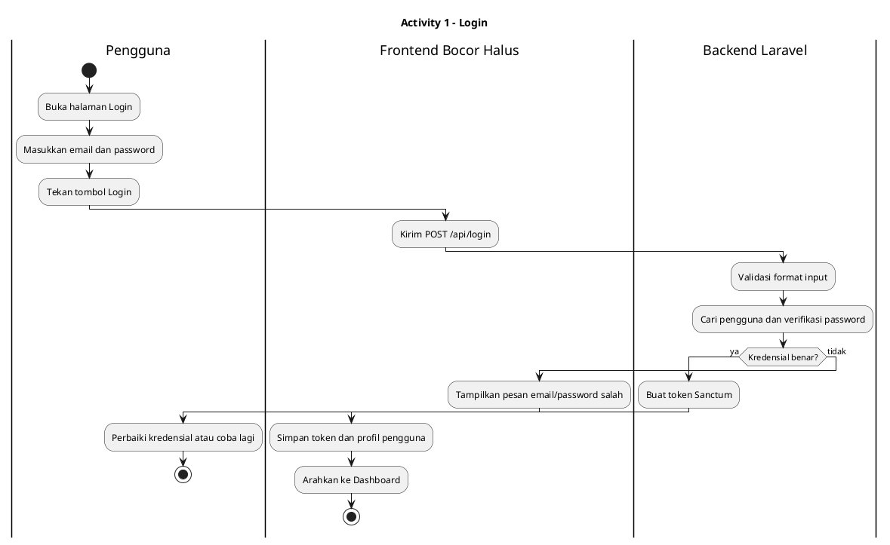

### Activity 2 — Register

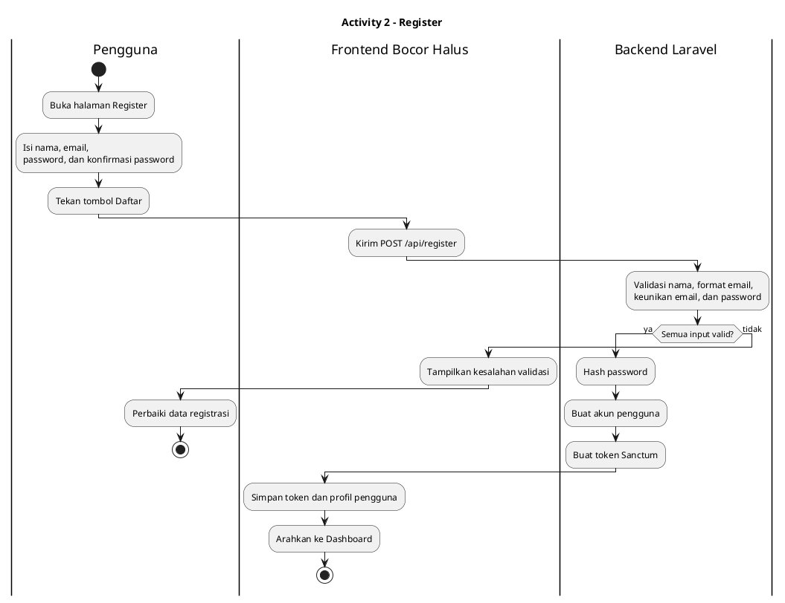

### Activity 3 — Logout

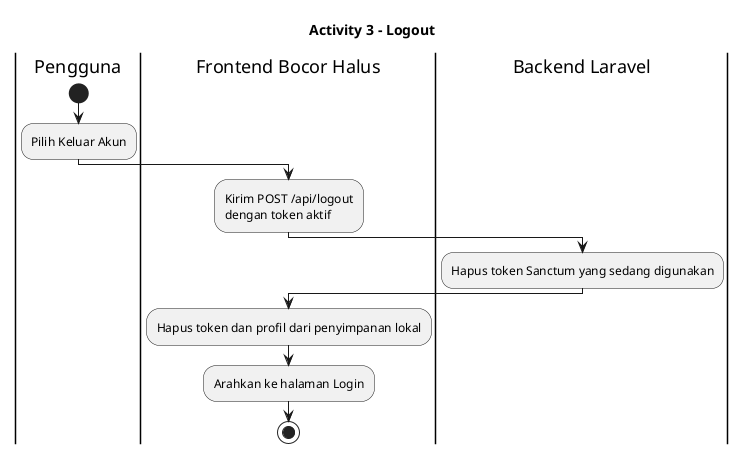

### Activity 4 — Mengelola Kategori

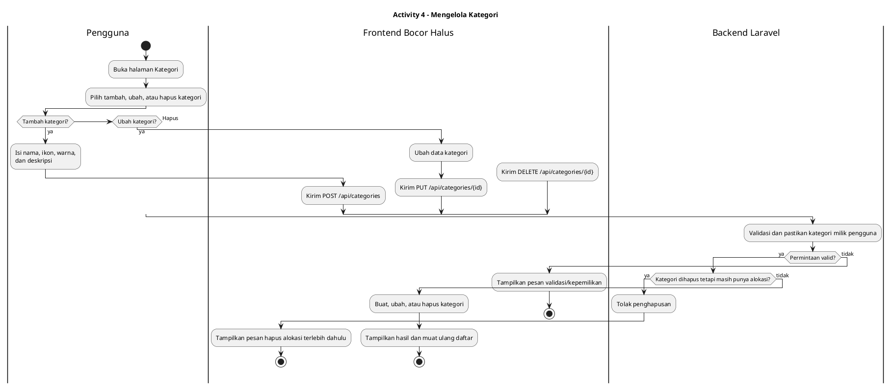

### Activity 5 — Menetapkan Target Bulanan

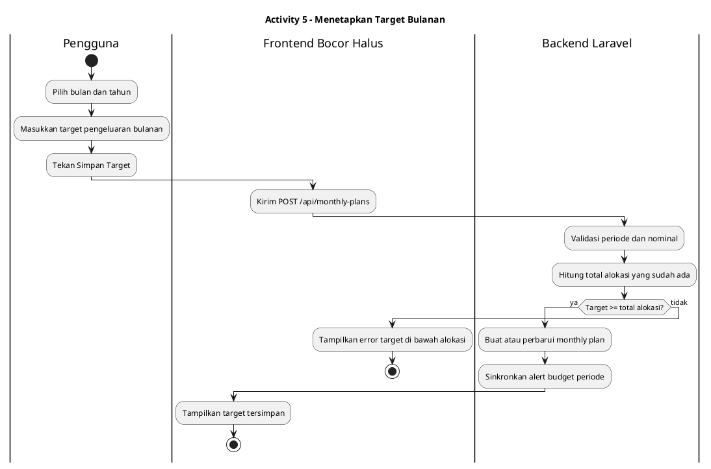

### Activity 6 — Mengelola Alokasi Budget Kategori

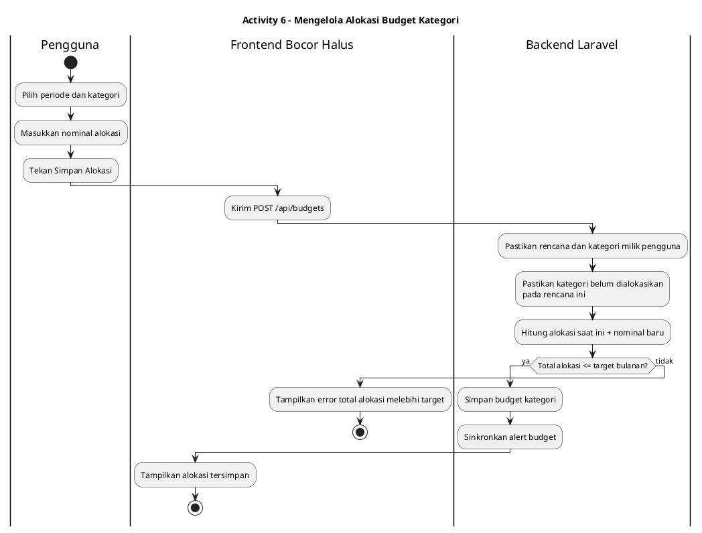

### Activity 7 — Melihat Dashboard

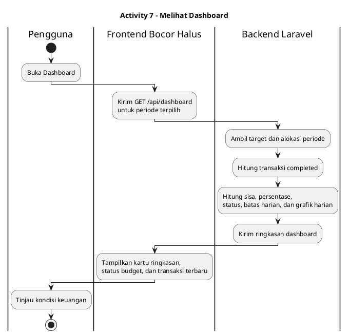

### Activity 8 — Mencatat Pengeluaran Manual

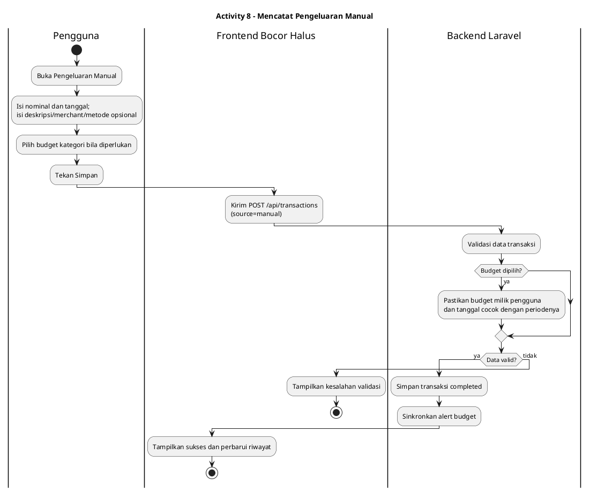

### Activity 9 — Scan Struk dan Mencatat Pengeluaran OCR

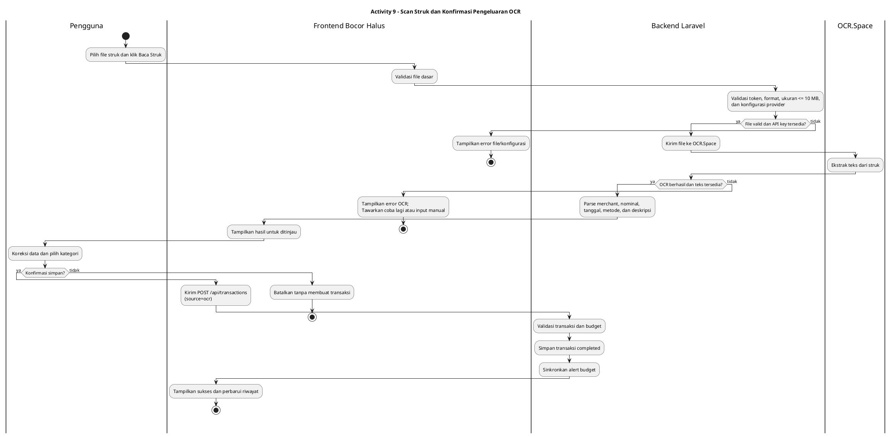

### Activity 10 — Melihat dan Memfilter Riwayat Pengeluaran

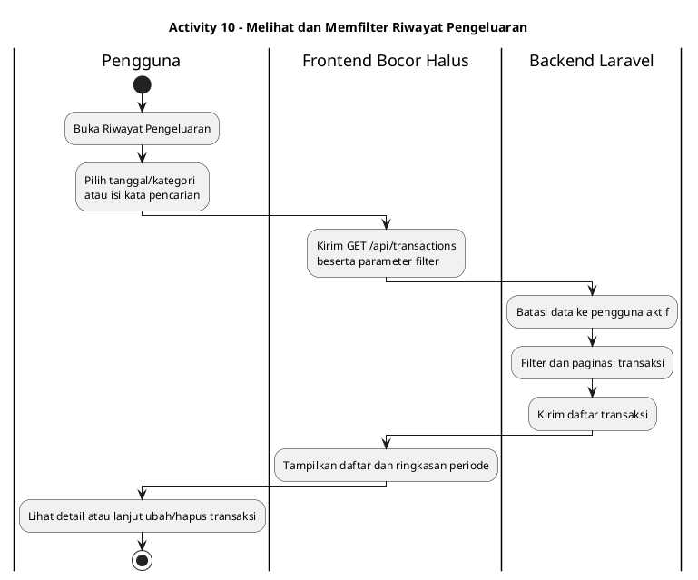

### Activity 11 — Mengubah atau Menghapus Pengeluaran

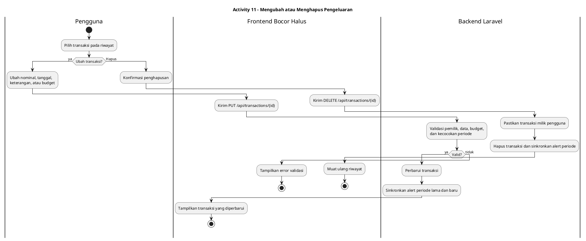

### Activity 12 — Mengelola Subscription

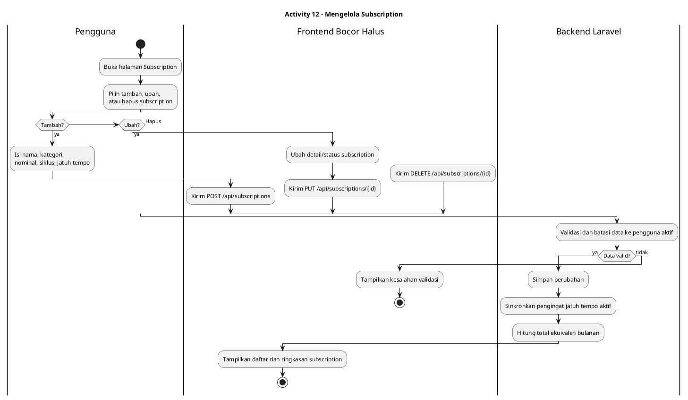

### Activity 13 — Melihat Laporan

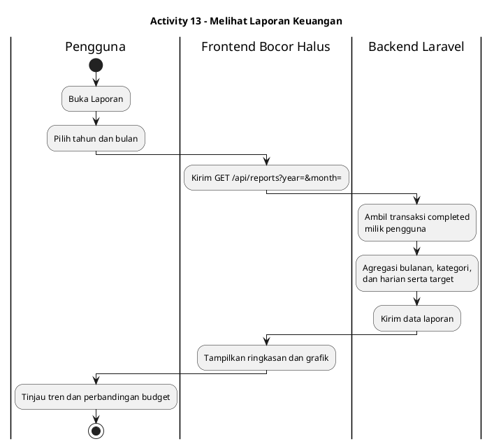

### Activity 14 — Melihat dan Menandai Notifikasi

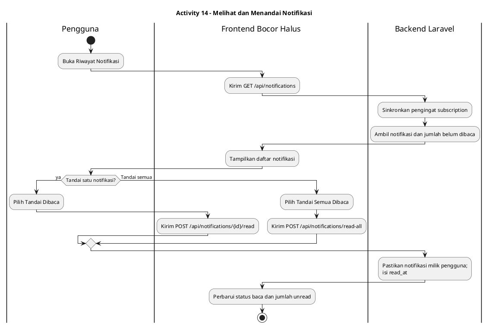

## 6. ERD / RAT

ERD berikut hanya menampilkan entitas bisnis utama. `personal_access_tokens`, `sessions`, `password_reset_tokens`, `cache`, dan `jobs` adalah tabel pendukung framework, bukan bagian inti domain keuangan.

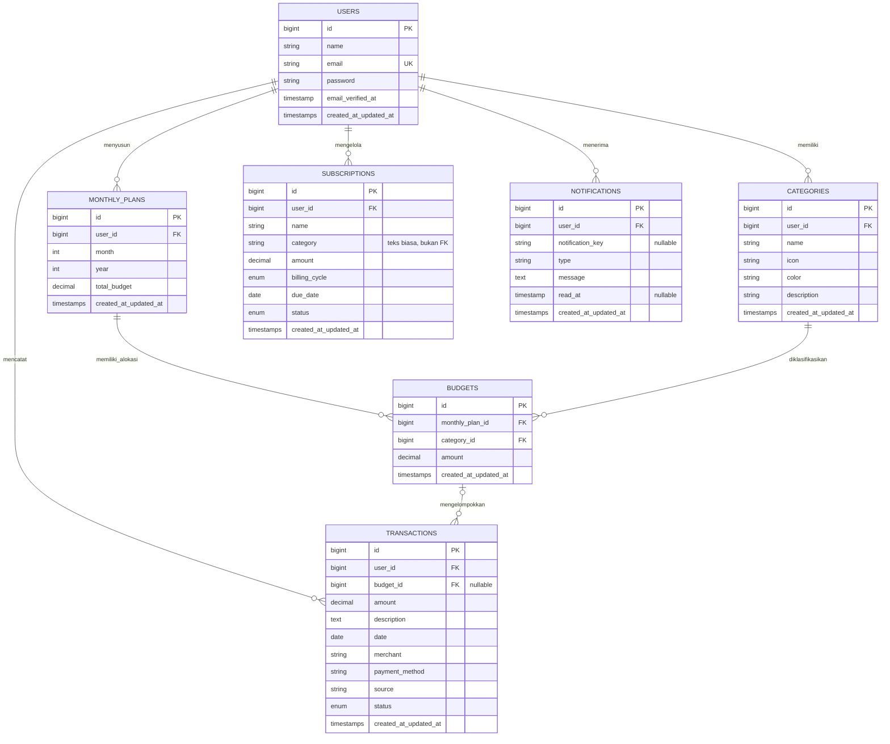

### Kardinalitas dan aturan foreign key

| Relasi | Kardinalitas | Aturan |
|---|---|---|
| `users` → `categories` | 1 : 0..N | Kategori dimiliki satu pengguna; menghapus pengguna menghapus kategori |
| `users` → `monthly_plans` | 1 : 0..N | Setiap rencana dimiliki satu pengguna; pasangan `(user_id, month, year)` unik |
| `monthly_plans` → `budgets` | 1 : 0..N | Hapus rencana menghapus alokasi budget terkait |
| `categories` → `budgets` | 1 : 0..N | Satu kategori dapat dialokasikan di banyak periode; pasangan `(monthly_plan_id, category_id)` unik |
| `users` → `transactions` | 1 : 0..N | Transaksi memiliki pemilik; menghapus pengguna menghapus transaksinya |
| `budgets` → `transactions` | 1 : 0..N, FK transaksi opsional | Transaksi boleh tanpa alokasi; menghapus budget mengubah `transactions.budget_id` menjadi `NULL` |
| `users` → `subscriptions` | 1 : 0..N | Subscription dimiliki satu pengguna |
| `users` → `notifications` | 1 : 0..N | Notifikasi dimiliki satu pengguna |

### Batas interpretasi ERD

- Tabel `budgets` merupakan entitas penghubung antara `monthly_plans` dan `categories`, sekaligus menyimpan nilai alokasi.
- `subscriptions.category` adalah teks biasa, bukan foreign key ke `categories`.
- `transactions.budget_id` boleh `NULL`. Relasi kategori transaksi didapat melalui `transactions.budget_id → budgets.category_id`.
- Tidak ada tabel terpisah untuk hasil OCR. Teks dan hasil parse hanya dikirim kembali untuk ditinjau; data permanen baru masuk ke `transactions` setelah konfirmasi pengguna.
- Database tidak mendefinisikan foreign key langsung yang memastikan `transactions.user_id` sama dengan pemilik monthly plan dari `budget_id`. Controller memvalidasi bahwa budget dimiliki pengguna dan tanggal transaksi berada pada periode budget tersebut.
- Nama kategori unik per pengguna diperiksa oleh validasi aplikasi; migration tidak mendefinisikan unique index untuk pasangan `(user_id, name)`.
- Notifikasi memiliki unique index `(user_id, notification_key)` untuk deduplikasi. `notification_key` nullable.

### Constraint dan nilai domain

| Tabel | Constraint/nilai penting |
|---|---|
| `users` | Email unik; password di-hash |
| `monthly_plans` | `month` 1–12; `year` 2000–2100 pada validasi API; target tidak boleh lebih kecil dari total alokasi |
| `budgets` | Nominal harus positif; total alokasi periode tidak boleh melampaui target bulanan |
| `transactions` | Nominal positif; `status`: `completed`, `pending`, `failed`; `source`: `manual` atau `ocr`; tanggal transaksi harus sesuai periode budget jika budget dipilih |
| `subscriptions` | Siklus: `monthly`/`yearly`; status: `active`/`inactive`/`cancelled`; nominal positif |
| `notifications` | `read_at = NULL` berarti belum dibaca; tipe budget: `budget_warning`, `budget_critical`, `budget_overbudget`; pengingat: `subscription_due` |

## 7. Aturan Bisnis untuk Diagram

1. Semua endpoint domain keuangan memerlukan autentikasi Sanctum.
2. Data kategori, rencana, transaksi, subscription, dan notifikasi dibatasi pada pengguna yang sedang login.
3. Satu pengguna hanya dapat memiliki satu rencana per bulan dan tahun.
4. Satu kategori hanya dapat memiliki satu alokasi pada rencana bulanan yang sama.
5. Jumlah seluruh alokasi kategori tidak boleh melebihi `monthly_plans.total_budget`.
6. Mengurangi target bulanan di bawah jumlah alokasi yang ada ditolak.
7. Jika transaksi memilih budget, budget harus milik pengguna dan tanggal transaksi harus berada dalam bulan/tahun budget.
8. Transaksi baru berstatus `completed`; dashboard dan laporan menghitung transaksi completed.
9. Persentase status budget: `aman` di bawah 50%, `waspada` mulai 50%, `kritis` mulai 80%, `overbudget` di atas 100%.
10. Notifikasi dibuat pada ambang 50%, 80%, dan **lebih dari** 100%; alert dideduplikasi berdasarkan pengguna dan kunci target/periode/ambang.
11. Subscription tahunan dihitung ekuivalen bulanan sebagai `amount / 12`; subscription nonaktif/dihentikan tidak masuk total langganan aktif.
12. Pengingat subscription dibuat saat tanggal jatuh tempo aktif berada dari hari ini sampai tujuh hari ke depan; sinkronisasi berlangsung ketika daftar subscription/notifikasi diminta atau data subscription disimpan/diperbarui, bukan melalui job scheduler periodik pada alur ini.
13. Hapus kategori yang masih dipakai alokasi ditolak. Hapus alokasi tidak menghapus transaksi; FK budget transaksi menjadi `NULL`.
14. OCR memakai file maksimal 10 MB dan format JPG/JPEG/PNG/WEBP/PDF. API key hanya berada di backend.
15. Hasil ekstraksi adalah heuristik dan bisa salah. Pengguna wajib meninjau/mengoreksi nominal, tanggal, merchant, kategori, dan metode pembayaran sebelum menyimpan.

## 8. Endpoint API untuk Sequence Diagram

Semua rute di bawah `/api`; rute selain registrasi/login berada di middleware `auth:sanctum`.

| Metode | Endpoint | Fungsi |
|---|---|---|
| `POST` | `/register` | Registrasi dan membuat token |
| `POST` | `/login` | Autentikasi dan membuat token |
| `POST` | `/logout` | Menghapus token aktif |
| `GET` | `/user` | Mendapatkan profil pengguna terautentikasi |
| `GET/POST` | `/categories` | Daftar/tambah kategori |
| `GET/PUT/DELETE` | `/categories/{id}` | Detail/ubah/hapus kategori |
| `GET/POST` | `/monthly-plans` | Daftar/buat atau perbarui target periode |
| `GET/PUT/DELETE` | `/monthly-plans/{id}` | Detail/ubah/hapus rencana |
| `GET/POST` | `/budgets` | Daftar alokasi berdasarkan `monthly_plan_id` / tambah alokasi |
| `PUT/DELETE` | `/budgets/{id}` | Ubah/hapus alokasi |
| `GET/POST` | `/transactions` | Daftar/filter/paginasi / buat transaksi |
| `GET/PUT/DELETE` | `/transactions/{id}` | Detail/ubah/hapus transaksi |
| `POST` | `/receipt-extractions` | Unggah struk ke OCR.Space dan kembalikan usulan hasil parse |
| `GET/POST` | `/subscriptions` | Daftar + ringkasan / tambah subscription |
| `GET/PUT/DELETE` | `/subscriptions/{id}` | Detail/ubah/hapus subscription |
| `GET` | `/dashboard?month=&year=` | Ringkasan keuangan dan status budget periode |
| `GET` | `/reports?year=&month=` | Data rekap tahunan, bulanan, kategori, dan harian |
| `GET` | `/notifications` | Riwayat notifikasi dan jumlah belum dibaca |
| `POST` | `/notifications/{id}/read` | Tandai satu notifikasi dibaca |
| `POST` | `/notifications/read-all` | Tandai semua notifikasi dibaca |

## 9. Sequence Diagram

Setiap diagram sequence di bawah menunjukkan **aktor**, **proses/komponen yang menjalankan langkah**, dan **tabel database yang dibaca atau ditulis**. Lifeline database diberi nama sesuai tabel aktual, bukan hanya satu lifeline “Database”. Interaksi dengan OCR.Space ditampilkan sebagai sistem eksternal dan tidak dianggap tabel database.

### 9.1 Sequence login

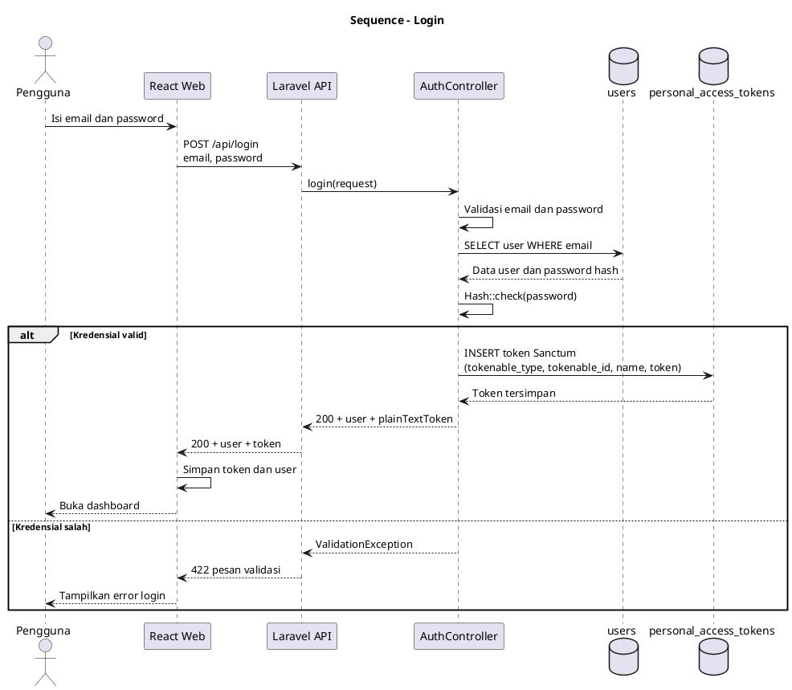

**Aktor:** Pengguna. **Proses:** validasi input, pencarian akun, verifikasi password, pembuatan token, penyimpanan token di frontend. **Tabel:** `users` dibaca; `personal_access_tokens` ditulis hanya jika kredensial valid.

### 9.2 Sequence pembuatan transaksi manual

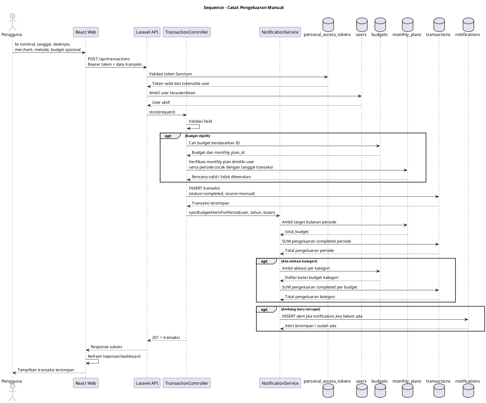

**Aktor:** Pengguna. **Proses:** autentikasi, validasi transaksi dan budget, simpan transaksi, hitung ambang, deduplikasi alert, refresh UI. **Tabel:** `personal_access_tokens`, `users`, `budgets` dan `monthly_plans` dibaca untuk autentikasi/validasi; `transactions` dibaca dan ditulis; `notifications` ditulis bila ambang tercapai.

### 9.3 Sequence ekstraksi OCR lalu simpan

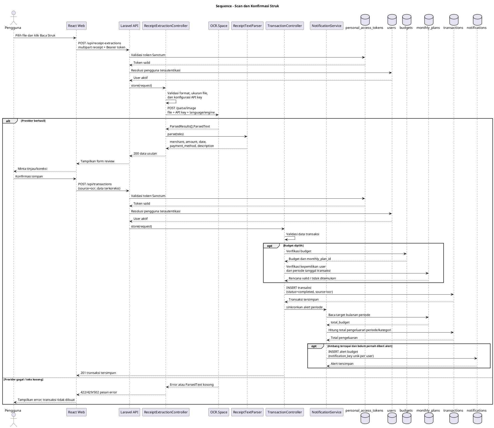

**Aktor:** Pengguna dan sistem eksternal OCR.Space. **Proses:** autentikasi, validasi file, ekstraksi teks, parsing, review/koreksi pengguna, validasi transaksi, simpan transaksi dan sinkronisasi alert. **Tabel saat ekstraksi:** `personal_access_tokens` dan `users` untuk autentikasi; tidak ada tabel domain yang ditulis atau dibaca untuk OCR. **Tabel saat konfirmasi simpan:** `budgets` dan `monthly_plans` dibaca bila budget dipilih; `transactions` ditulis/dibaca untuk ringkasan pengeluaran; `notifications` ditulis bila alert baru perlu dibuat. Jika OCR gagal atau pengguna membatalkan, tabel `transactions` tidak berubah.

### 9.4 Sequence perubahan budget dan notifikasi

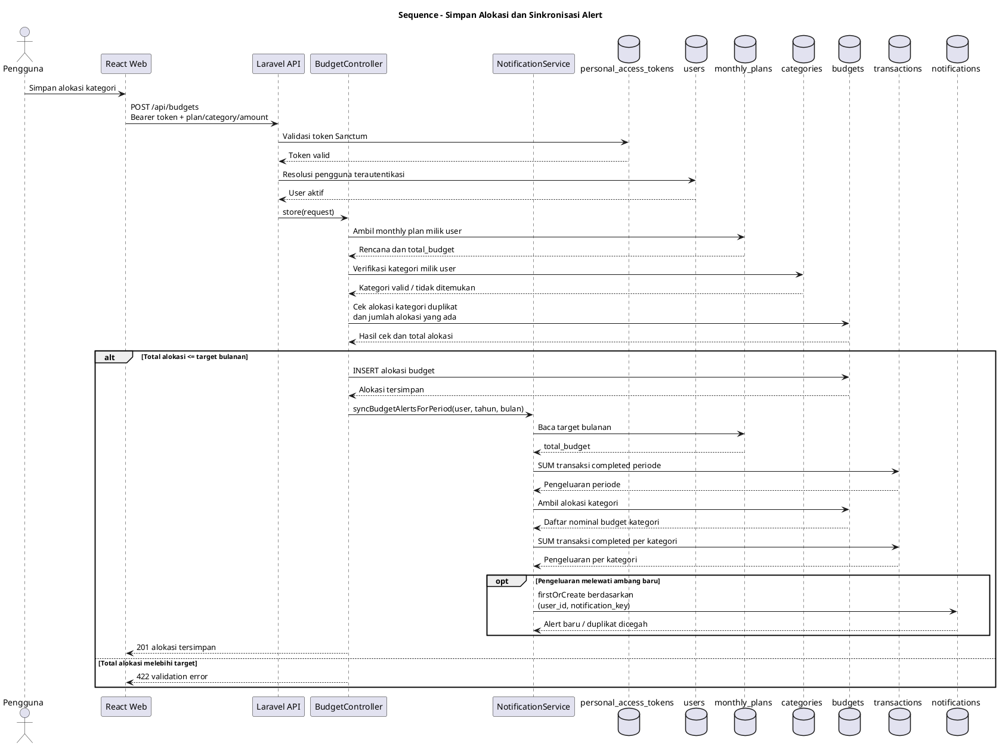

**Aktor:** Pengguna. **Proses:** autentikasi, verifikasi pemilik rencana/kategori, validasi batas alokasi, simpan budget, hitung penggunaan dan buat alert bila perlu. **Tabel:** `personal_access_tokens` dan `users` untuk autentikasi; `monthly_plans`, `categories`, `budgets`, `transactions` dibaca; `budgets` ditulis jika valid; `notifications` ditulis bila ambang baru tercapai.

## 10. Spesifikasi Data untuk Laporan dan Dashboard

- Dashboard menerima `month` dan `year`; bila tidak diberikan, backend menggunakan periode sekarang.
- Total budget dashboard berasal dari `monthly_plans.total_budget`; total pengeluaran dihitung dari transaksi completed pada bulan itu.
- Sisa = target bulanan − total pengeluaran. Batas harian dihitung untuk periode sekarang berdasarkan sisa positif dibagi hari tersisa (termasuk hari ini).
- Laporan mengembalikan 12 total bulanan untuk tahun pilihan, perbandingan budget bulanan, pengeluaran per kategori untuk bulan terpilih, serta total harian.
- Transaksi tanpa budget/kategori dilaporkan sebagai **Tanpa kategori**.
- Endpoint daftar transaksi menyediakan filter tanggal, kategori/budget, pencarian teks merchant/deskripsi, urutan terbaru, dan paginasi 20 item.

## 11. Skenario Alternatif dan Error

| Kondisi | Perilaku sistem |
|---|---|
| Token tidak valid/tidak ada pada rute terlindungi | API menolak akses (401) |
| Input tidak valid | API mengembalikan error validasi (umumnya 422); UI menampilkan pesan |
| Target lebih kecil daripada alokasi yang ada | Target ditolak |
| Alokasi baru membuat jumlah melebihi target | Alokasi ditolak |
| Kategori masih dipakai alokasi | Penghapusan kategori ditolak (409) |
| Budget tidak dimiliki pengguna/tanggal beda periode | Transaksi ditolak |
| API key OCR tidak tersedia | Endpoint ekstraksi mengembalikan 503 |
| Koneksi provider gagal | Endpoint ekstraksi mengembalikan 502; transaksi belum dibuat |
| OCR menolak atau tidak membaca teks | Endpoint ekstraksi mengembalikan 422 (atau 429 bila limit); pengguna dapat mencoba lagi/manual |
| Pengguna membatalkan review OCR | Tidak ada pemanggilan simpan transaksi |
| User mengakses ID data milik user lain | Resource tidak ditemukan dari query berlingkup pengguna (404) |

## 12. Pemetaan Modul ke Diagram yang Disarankan

| Diagram | Cakupan yang disarankan |
|---|---|
| Use Case | Seluruh UC-01 sampai UC-13; aktor Pengguna dan OCR.Space |
| Activity | Diagram terpisah untuk Login, Register, Logout, kategori, target, alokasi, dashboard, transaksi manual, scan OCR, riwayat, ubah/hapus transaksi, subscription, laporan, dan notifikasi (Activity 1–14) |
| ERD/RAT | Tujuh entitas domain: users, categories, monthly_plans, budgets, transactions, subscriptions, notifications |
| Sequence | Login; transaksi manual; scan OCR lalu konfirmasi; tambah alokasi dan pembentukan alert; tandai notifikasi dibaca |

Untuk diagram tugas/laporan, sebutkan dengan tegas bahwa OCR.Space adalah aktor eksternal hanya pada use case ekstraksi. Penyimpanan transaksi merupakan use case terpisah yang memerlukan konfirmasi pengguna.
